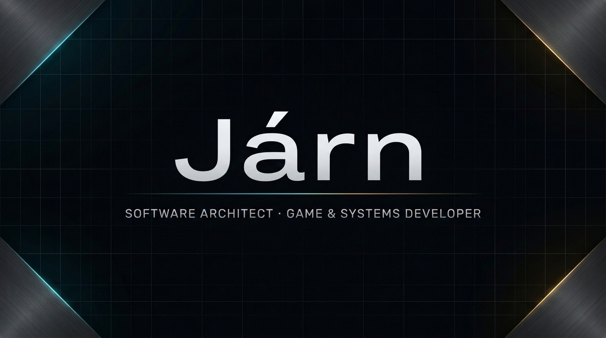

  

<h2 align="center">Járn</h2>

  <b>Software Architect · Game, Mobile &amp; Systems Developer</b> 
  Real-time 3D engines, cross-platform apps, low-level systems &amp; embedded automotive

  
  

---

### Core Stack

  
  
  
  
  
  
  
  
  
  
  

### What I Build

- **Games & Real-Time 3D** — Gameplay architecture, physics, custom renderers &amp; shaders at **[Lumark Games](https://github.com/lumarkgames)**
- **Mobile & Web** — Cross-platform mobile apps, edge APIs, and interactive frontends
- **Systems & Tooling** — Low-level utilities, CLI automation, and Linux desktop environments
- **Automotive & Embedded** — Native infotainment apps &amp; real-time telemetry at **[iDrive Labs](https://github.com/idrive-labs)**

### Selected Open Source

| Project | Focus |
|---|---|
| **[Sideways](https://github.com/idrive-labs/sideways)** | Real-time vehicle telemetry, Kalman-filtered slip estimation, OpenGL ES 3D replay engine, QHD video export &amp; signed cloud leaderboard |
| **[MGU Apps](https://github.com/idrive-labs/mgu-apps)** | Distribution catalog &amp; package pipeline for native automotive apps |
| **[dotfiles](https://github.com/jarnesence/dotfiles)** | Hyprland terminal-zen Linux environment with palette-driven theming &amp; automated setup |
