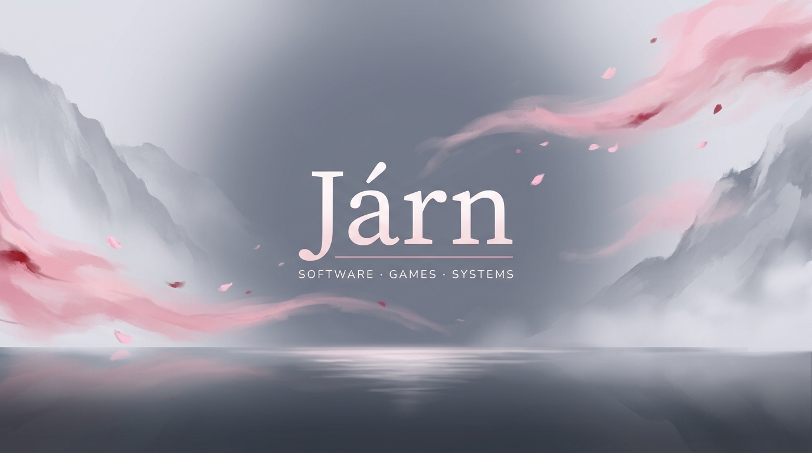

  

<h2 align="center">Járn</h2>

  <b>Software, Game &amp; Mobile Developer</b> 
  Real-time 3D engines, cross-platform apps, private client systems &amp; embedded automotive

  
  

---

### Core Stack

  
  
  
  
  
  
  
  
  
  
  

### What I Build

- **Unannounced Multiplayer Game ([Lumark Games](https://github.com/lumarkgames))** — Currently in active development (`Closed-Source`); real-time multiplayer architecture, gameplay systems &amp; custom shaders *(details kept private)*.
- **Interactive 3D &amp; VR Experiences (`Closed-Source / NDA`)** — Real-time spatial applications, interactive installations &amp; exhibition builds in Unreal Engine / Unity.
- **Enterprise &amp; Internal Systems (`Closed-Source / NDA`)** — Custom internal company tools, workflow automation, desktop/web control panels &amp; telemetry pipelines.
- **Mobile &amp; Backend Platforms (`Closed-Source / NDA`)** — Cross-platform iOS/Android applications, low-latency APIs &amp; edge services.
- **Automotive &amp; Embedded ([iDrive Labs](https://github.com/idrive-labs))** — Native head-unit apps &amp; real-time vehicle telemetry for BMW iDrive 7 &amp; 8.

### Selected Open Source

| Project | Focus |
|---|---|
| **[Sideways](https://github.com/idrive-labs/sideways)** | Real-time vehicle telemetry, Kalman-filtered slip estimation, OpenGL ES 3D replay engine, QHD video export &amp; signed cloud leaderboard |
| **[MGU Apps](https://github.com/idrive-labs/mgu-apps)** | Distribution catalog &amp; package pipeline for native automotive apps |
| **[dotfiles](https://github.com/jarnesence/dotfiles)** | Hyprland terminal-zen Linux environment with palette-driven theming &amp; automated setup |
