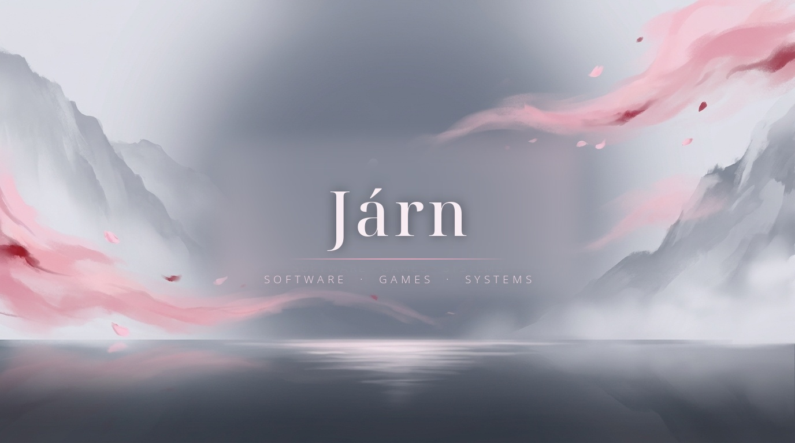

  

<h2 align="center">Járn</h2>

  <b>Software, Game &amp; Mobile Developer</b> 
  Real-time 3D engines, interactive installations, enterprise systems, mobile &amp; web applications

  

---

### Core Stack

  
  
  
  
  
  
  
  
  
  
  
  
  
  
  

### Currently Building

- **Unannounced Multiplayer Game ([Lumark Labs](https://github.com/lumark-labs))** — Active development (`Closed-Source`); real-time multiplayer architecture, gameplay systems &amp; custom shaders *(details kept private)*.

---

### Closed-Source &amp; Commercial Portfolio

> *Shareable commercial, B2B, and internal projects below. Additional client and enterprise engagements remain undisclosed under NDA.*

<b>Trade Show &amp; Event Booth Apps (6)</b>

| Project | Scope | Stack | Model |
|---|---|---|---|
| **VexelDeck** | Interactive touchscreen presentation app for 55-inch trade show kiosk displays | Unity, C#, Linux (Ubuntu Kiosk) | Closed-Source / B2B |
| **LoomaTap** | Touchscreen trivia &amp; prize-wheel mini-game for booth engagement and lead capture | JS, HTML5 Canvas, Node.js, SQLite | Closed-Source / B2B |
| **CorvusX** | Interactive 3D heavy-machinery inspection app with X-ray transparency toggle | Unreal Engine, C++ | Closed-Source / B2B |
| **Kinetra** | Motion-sensor reflex game using depth-camera hand gestures at tech expos | Unity, Depth Camera SDK, Linux | Closed-Source / B2B |
| **BrambleTag** | Visitor badge &amp; QR code scanning module with automated brochure delivery &amp; CRM sync | React, Node.js, Linux Server | Closed-Source / B2B |
| **TesselWall** | Frame-synchronized multi-screen visual controller across 3 vertical displays | Unity, UDP Sync, Linux | Closed-Source / B2B |

<b>3D Configurators &amp; WebGL (5)</b>

| Project | Scope | Stack | Model |
|---|---|---|---|
| **Plintho** | Browser-based 3D kitchen &amp; cabinet configurator with instant pricing quotes | Three.js, JavaScript, REST API | Closed-Source / B2B &amp; B2C |
| **SpokeForge** | 360-degree web wheel &amp; exterior accessory preview embedded in e-commerce | Unity (WebGL), JS Bridge | Closed-Source / B2C |
| **StrataLens** | Interactive real-estate building scale model, unit selector &amp; 360° interior tours | Unreal Engine (Pixel Streaming), Docker, JS | Closed-Source / B2B &amp; B2C |
| **FoldCraft** | Browser-based 3D packaging &amp; box mockup generator with artwork upload | Babylon.js, Node.js | Closed-Source / B2B |
| **LumenCast** | Photometric light distribution preview module for architectural lighting catalogs | Unreal Engine, Web UI (JS) | Closed-Source / B2B |

<b>Corporate Training &amp; Visual Tools (4)</b>

| Project | Scope | Stack | Model |
|---|---|---|---|
| **VigilRoom** | 10-minute VR occupational health &amp; safety (OHS) orientation for plants &amp; warehouses | Unity, C#, Meta Quest SDK | Closed-Source / Internal |
| **TorqueStep** | Step-by-step 3D installation &amp; maintenance guide for CNC/packaging machinery | Unity, C#, Windows / Tablet | Closed-Source / B2B |
| **BespokeDeck** | Interactive product-feature training &amp; scenario assessment platform for retail staff | Vue.js, Node.js, PostgreSQL | Closed-Source / Internal |
| **BayGrid** | Internal 3D warehouse rack &amp; inventory occupancy visualizer synced to ERP data | Three.js, JS, Linux Backend | Closed-Source / Internal |

<b>Advergames &amp; Brand Gamification (3)</b>

| Project | Scope | Stack | Model |
|---|---|---|---|
| **BrewDash** | 1-minute order-preparation mini-game for mobile WebView &amp; web loyalty campaigns | Unity (WebGL), JS, Node.js API | Closed-Source / B2C |
| **BinCycle** | Tablet-based waste sorting &amp; recycling awareness game for schools and public events | Unity, C#, Android | Closed-Source / CSR |
| **PulseStage** | Real-time multiplayer trivia platform for hundreds of concurrent attendees | JS, Socket.io, Node.js, Linux | Closed-Source / B2B |

<b>Linux Infrastructure &amp; Kiosk Ops (4)</b>

| Project | Scope | Stack | Model |
|---|---|---|---|
| **BareBoot** | Hardened minimal Linux OS image booting directly into fullscreen 3D/Web apps | Debian/Ubuntu, Bash, Systemd | Closed-Source / Infrastructure |
| **SentinelD** | Background watchdog daemon monitoring 3D app health, freezes &amp; auto-restart | Node.js, Systemd, WebSockets | Closed-Source / Infrastructure |
| **NodeBeacon** | Web fleet-management dashboard for device thermals, asset sync &amp; scheduled shutdowns | React, Node.js, Linux SSH/API | Closed-Source / Infrastructure |
| **CacheHarbor** | Local LAN edge content-delivery server for offline exhibition environments | Linux (Nginx, Docker), Node.js | Closed-Source / Infrastructure |

---

### Open Source

- **[dotfiles](https://github.com/jarnesence/dotfiles)** — Hyprland terminal-zen Linux environment with palette-driven theming &amp; automated setup

#### For Fun *(Weekend / Hobby)*

> *Personal side experiments built for fun outside of commercial work.*

| Project | Focus |
|---|---|
| **[Sideways](https://github.com/idrive-labs/sideways)** | Real-time drift telemetry, 3D replay engine &amp; QHD video export for BMW iDrive 7 &amp; 8 |
| **[MGU Apps](https://github.com/idrive-labs/mgu-apps)** | Hobby MGU Store distribution source at [@idrive-labs](https://github.com/idrive-labs) |
